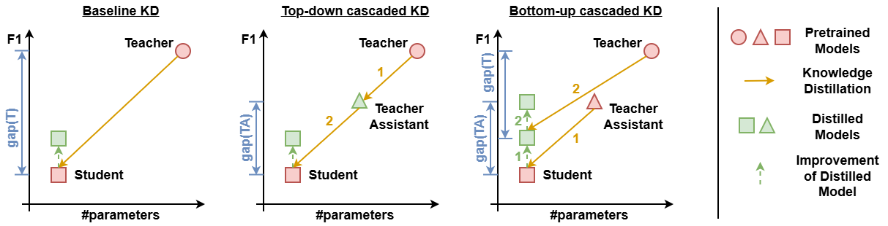

# LLaVA-CKD: Bottom-Up Cascaded Knowledge Distillation for Vision-Language Models

<h3 align="center">
  <a href="https://arxiv.org/abs/2605.10641">arXiv</a> |
  <a href="https://huggingface.co/collections/CERTH-ITI-IDT/ckd-llava">Hugging Face</a>
</h3>



## Contents ✨

- [Todo List](#todo-list-)
- [News](#news-)
- [Overview](#overview-)
- [Getting Started](#getting-started-)
- [Citation](#citation-)

## TODO List 📅

We will release the code and checkpoints as soon as the paper is accepted. Stay tuned! 🔥

- [x] Release environment setup
- [ ] Release checkpoints
- [ ] Release code

## News 📢

- **`2026/09/08`** TinyLLaVA checkpoints publicly released in [Hugging Face](https://huggingface.co/CERTH-ITI-IDT/models). All LLaVA-CKD checkpoints privately uploaded (including LLaVA-KD ones) in [Hugging Face](https://huggingface.co/collections/CERTH-ITI-IDT/ckd-llava). 🔥
- **`2026/05/11`** LLaVA-CKD [paper](https://arxiv.org/abs/2605.10641) is available on arXiv. 🌟

## Overview 🔥

Large Vision-Language Models (VLMs) are successful in addressing a multitude of vision-language understanding tasks, such as Visual Question Answering (VQA), but their memory and compute requirements remain a concern for practical deployment. A promising class of techniques for mitigating this concern is Knowledge Distillation, where knowledge from a high-capacity Teacher network is transferred to a considerably smaller Student network. However, the capacity gap between the two networks is both a blessing and a curse: the smaller the Student network, the better its efficiency, and the larger the Teacher, the more knowledge it carries; yet, beyond a point, the larger capacity gap between the two leads to worse knowledge transfer. To counter this effect, we propose a bottom-up cascaded knowledge distillation (CKD) framework. Instead of treating knowledge transfer as an activity involving one high-capacity Teacher (or an ensemble of such), inspired by human formal education systems, we introduce one (potentially, more) additional Teacher(s) of intermediate capacity that gradually bring the Student network to the next level, where the next (higher-capacity) Teacher can take over. We provide a theoretical analysis in order to study the effect of cascaded distillation in the generalization performance of the Student. We apply the proposed framework on models build upon the LLaVA methodology and evaluate the derived models on seven standard, publicly available VQA benchmarks, demonstrating their SotA performance.

## Getting Started 🛠️ 

1. [Environment Installation](docs/Install.md)
2. [Training Data](docs/training_data.md)
3. [Training](docs/Training.md)
4. [Evaluation](docs/Evaluation.md)

## Citation 📝

If you find our project useful for your research please consider citing our paper:

```bibtex
@misc{gkalelisMezarisArxiv2026,
      title={LLaVA-CKD: Bottom-Up Cascaded Knowledge Distillation for Vision-Language Models}, 
      author={Nikolaos Gkalelis and Vasileios Mezaris},
      year={2026},
      eprint={2605.10641},
      archivePrefix={arXiv},
      primaryClass={cs.CV},
      url={https://arxiv.org/abs/2605.10641}, 
}
```

## LLaVA-CKD builds on: 🤝

- [LLaVA-KD](https://github.com/fantasyele/llava-kd)
- [TinyLLaVA](https://github.com/tinyllava/tinyllava_factory)
- [LLaVA](https://github.com/haotian-liu/LLaVA)
- [Qwen2.5](https://github.com/QwenLM/Qwen2.5)

## Acknowledgement 🌟

This work was supported by the EU’s Horizon Europe programme under grant agreement 101214398 ELLIOT.

## License :dizzy:

This code is provided for academic, non-commercial use only. Please also check for any restrictions applied in the code parts, trained models, and datasets used here from other sources. For the materials not covered by any such restrictions, redistribution and use in source and binary forms, with or without modification, are permitted for academic non-commercial use provided that the following conditions are met:

Redistributions of source code must retain the above copyright notice, this list of conditions and the following disclaimer. Redistributions in binary form must reproduce the above copyright notice, this list of conditions and the following disclaimer in the documentation provided with the distribution.

This software is provided by the authors "as is" and any express or implied warranties, including, but not limited to, the implied warranties of merchantability and fitness for a particular purpose are disclaimed. In no event shall the authors be liable for any direct, indirect, incidental, special, exemplary, or consequential damages (including, but not limited to, procurement of substitute goods or services; loss of use, data, or profits; or business interruption) however caused and on any theory of liability, whether in contract, strict liability, or tort (including negligence or otherwise) arising in any way out of the use of this software, even if advised of the possibility of such damage.


